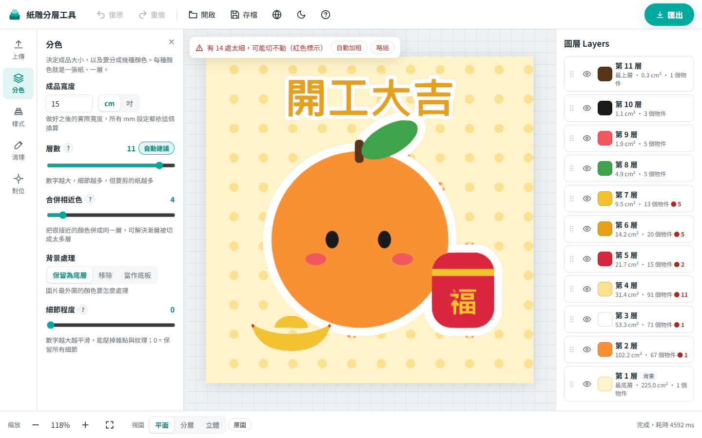

# 紙雕分層工具（Cricut 相容）

上傳一張平面插畫，工具會自動依顏色分成多層，產生每一層的切割用 SVG。用彩色紙分別切割後一層層疊貼，就是立體紙雕。

**線上使用：https://teapotpot312.github.io/paper-layer-tool/**

- **完全免費、純前端**：所有運算都在瀏覽器裡完成，圖片不會上傳到任何伺服器。
- **單一 HTML 檔**：`npm run build` 產生的 `dist/index.html` 雙擊即可使用，斷網也能用；也可以直接放到 GitHub Pages / Cloudflare Pages。
- 介面預設繁體中文，可切換 English；支援亮色 / 暗色、桌機 / 平板 / 手機。



## 使用方式

1. 打開 `dist/index.html`（或開發模式的網址）。
2. 把圖片拖進畫面、按「上傳檔案」，或直接 `Ctrl+V` 貼上。支援 PNG / JPG / WebP / SVG。還沒有圖片的話，首次導覽的最後一步可以「用範例圖片試試看」（之後可按頂部的 `?` 重新打開導覽）。
3. 上傳後會**自動分層**，不需要按開始。左側工具列依設定的必要性排序（① 分色、② 樣式必做，③ 清理、④ 對位可略過）：
   | 面板 | 控制項 |
   |---|---|
   | ① 分色 | 成品寬度（cm / 吋）、層數（2–12，預設自動建議）、合併相近色、背景處理（保留 / 移除 / 當作底板）、細節程度 |
   | ② 樣式 | **作品樣式**四選一，疊層方式、泡棉與鏤空一起設定好：平貼（累加、不墊泡棉）/ 輕微立體（累加、主角與上方小細節墊泡棉）/ 強烈立體（累加、除最底層外每層墊泡棉）/ 鏤空剪紙（每層只剪自己的顏色、保留鏤空、不墊泡棉）。選中的卡片會顯示目前有幾層墊泡棉；按「ⓘ 樣式說明」會開啟四種樣式的示意圖（上排是完成後的斜角立體圖，下排是側面剖面，標出紙、泡棉與鏤空處），點選任一種即可套用。另有自動排序（預設面積大→小，也可選亮→暗）；進階設定只有一個滑桿：鏤空剪紙時是向外延伸量，其他樣式是泡棉墊片內縮量（預設 1 mm）。 |
   | ③ 清理（選用） | 最小碎片（mm²）、填補小洞、**邊緣平滑度**（邊緣有不規則凹凸時調高，尖角會保留）、最小可切寬度；過細區域以**紅色閃爍**標示，可選「略過 / 自動加粗 / 移除」 |
   | ④ 對位（選用） | 四角對位記號（預設比照 Cricut 的 **L 型角**，也可選圓孔 / 十字）、邊距、大小、層編號 |
4. 右側圖層面板：顯示 / 隱藏、點色塊改色、雙擊改名、拖曳排序（或選取後 `Alt+↑/↓`）。選取某層時其他層會淡化，並可**覆寫**該層的外擴、鏤空（保留 / 填滿）、泡棉（平貼 / 墊泡棉）與預覽用的泡棉厚度。每項預設跟隨全域設定，改過的項目標示「● 已覆寫」（圖層列表也會出現橘色小圓點），可按「還原為全域」。
5. 底部切換**平面 / 分層 / 立體**檢視；立體檢視可拖曳旋轉，並調整全域泡棉厚度；只有墊泡棉的層會被墊高。
6. 按右上角「**匯出**」選擇匯出方式並下載：
   - **純切割（建議）**：預設下載**單一多圖層 SVG** `artwork.svg`。所有層在同一個檔案、每層一個 `<g id="layer-01">`、填色互不相同、座標原點一致。兩層顏色相同時（例如手動改色），匯出時會自動把後面那層微調 1 個 RGB 值並在面板上警告，避免 Design Space 把它們併成同一層。有墊泡棉的層另外可下載 `foam-pads.svg`（全部墊片一個檔，灰階各差 1）。
   - **備用：每層獨立 SVG**（`layer-01-#E86F3D.svg`…）：可「逐檔下載」或「打包 ZIP 下載」（ZIP 另含 `artwork.svg`、泡棉墊片與紙張清單）。**ZIP 需先解壓縮，Design Space 無法直接上傳 ZIP 或資料夾**：Windows 在 ZIP 上按右鍵 →「全部解壓縮」，Mac 雙擊即可。
   - **列印再切割（Print Then Cut）**：每層與合成圖的 300 DPI PNG（透明背景、四周留白），超過尺寸上限會自動縮小。
   - **說明書與預覽**：A4 PDF 製作說明書（縮圖、紙張清單、層疊順序、步驟）＋立體預覽 PNG。

快捷鍵：`Ctrl+Z` 復原、`Ctrl+Y` / `Ctrl+Shift+Z` 重做（最多 50 步）、`Ctrl+S` 存專案、`Ctrl+0` 符合視窗、滑鼠拖曳平移、滾輪縮放。

專案可存成 `.json`（含參數與原圖 base64），之後用「開啟」重新載入；另外會自動暫存在 IndexedDB，下次開啟時詢問是否還原（瀏覽器不支援時會安靜略過）。

網址加上 `#sample`（例如 `index.html#sample`）會直接開啟範例圖。

### 匯入 Cricut Design Space

1. 下載 `artwork.svg`。
2. 開啟 Design Space →「上傳 Upload」→「瀏覽 Browse」。
3. 選擇檔案後按「儲存 Save」。
4. 插入畫布。Design Space 會依顏色把它拆成右側的各個圖層。

**多圖層 SVG 匯入後的拆層行為需由使用者以 Design Space 實測確認。** 若拆層不正確，改用備用的每層獨立 SVG：逐檔下載，或下載 ZIP 後**先解壓縮**，再一個一個上傳（各來源對「能否一次選取多個檔案上傳」說法不一，請不要假設可行）。所有層使用相同畫布大小與座標原點，在 Design Space 中位置會對齊。
4. Print Then Cut：上傳 PNG → 選「Print Then Cut」→ 依畫面指示列印與切割。黑色對位線由 Design Space 自動加上，本工具不會也不應畫。

> **需要使用者以 Design Space 實測**：匯出的 SVG 已用瀏覽器實際繪製驗證（尺寸、孔洞為透明、各層顏色分開、無濾鏡 / 遮罩 / clipPath / 點陣圖 / 文字），但我無法在這個環境中執行 Cricut Design Space，請以實機確認。

## 開發

```bash
npm install
npm run dev      # 開發伺服器
npm test         # 單元測試與驗收測試（Vitest）
npm run build    # 型別檢查 + 產生單一檔案 dist/index.html
```

### 專案結構

```
src/
├─ app/       React 介面（App、Sidebar、CanvasView、LayerPanel、ExportDialog、Tour、styles.css）
├─ worker/    影像處理管線（quantize、mask、trace、pipeline、worker）
├─ lib/       色彩轉換、型別、SVG 輸出、匯出（ZIP / PNG / PDF）、專案存檔、圖片載入
├─ i18n/      zh-TW、en
└─ assets/    內建範例插畫（程式繪製）
tests/        管線單元測試（量化、連通區域、輪廓追蹤、偏移、SVG 輸出）與驗收測試
docs/         驗收截圖
```

### 演算法管線（Web Worker 內執行，各段以參數快取）

1. **預處理**：處理用影像統一縮放到長邊 1200px（超過 4000px 會提示已縮小）；Alpha < 128 視為透明；「細節程度」> 0 時做 3×3 中值濾波（預設 0，因為會吃掉細線）。**原圖比 1200px 小時**，放大後的邊緣是假漸層：調色盤一律在原圖解析度（最多 600px）取樣；放大 2 倍以上的小圖，像素分配也在原圖解析度做，再以雙線性投票平滑放大標籤圖。
2. **顏色量化**：CIE Lab 空間 K-means++（固定種子，可重現），在 600px 縮圖上計算，草稿與精確結果共用同一組顏色。
   - **只取樣色塊內部**（與 8 鄰居色差都 < 5 的像素），反鋸齒邊緣的混色不會佔用顏色名額。
   - **漸層合併**：兩群顏色在平坦像素之間平滑相鄰（每步色差 < 1）的長度達色塊邊長 2.2 倍以上，視為明顯漸層一定合併；較短的柔邊交界（例如衣服上的淺灰陰影）只有在色差小於「合併相近色」時才合併，交給使用者決定。
   - **細線色救援**：只出現在細線上的顏色（描邊、手寫字）不在色塊內部；若邊緣像素既不接近任何主色、也不是附近色塊的混色，就另外分群補進調色盤。補進來的顏色須與所有主色差 ≥ 20、亮度不能落在兩側色塊之間，也不能是任兩個或任三個主色在 RGB 空間的混色（三色交會處的反鋸齒）。
   - 「合併相近色」以 CIE76 ΔE 門檻做階層式合併（預設 4，保留陰影這類低對比細節）；面積 < 2% 且色差 > 6 的色塊需 ΔE < 門檻×0.6 才會被併掉（保護黑眼睛這類小面積高對比色，幾乎同色的雜訊照常合併）。自動建議先分 16 色、最多 12 色。
   - **遺漏色補抓**：面積很小又細的獨特顏色（例如藍色虹膜）幾乎沒有色塊內部像素。掃描所有像素，找出離所有色群都很遠、不是任兩色或三色混色、且成塊（8 鄰居至少 4 個相近）的像素，另外分群補進來。
3. **像素分配與清理**：色塊內部直接取最近色；邊緣像素若能解釋成附近兩個色塊的混色，就歸給較接近的一側（不會多出一圈雜色）；單一底色上的細線像素偏向細線色超過 35% 就保留。接著做**雜邊清除**：夾在兩種顏色之間、本身又是這兩色中段混色的細窄色帶（例如綠葉與白底之間的米黃邊）改歸較接近的一側。之後只清掉被包圍的孤立雜點，同色連通區域（8 連通，斜線不會被拆碎）小於「最小碎片」者併入鄰近色（同時考慮接觸長度與色差，細長的淺綠碎片會併回綠色而不是被白底吃掉）；小於門檻的孔洞填補。
4. **過細偵測**：以歐氏距離轉換（Felzenszwalb）做半徑 = 最小寬度/2 的開運算，開運算去不掉的部分即為過細區域（精確結果在半解析度上計算，精度約 0.25mm）；「自動加粗」以同半徑外擴補強，「移除」直接剔除。
5. **疊層**：累加模式第 N 層 = 本層 ∪ 上方所有層；獨立模式以圓形結構元素外擴「向外延伸」mm（等同 round join 的 offset），但外擴部分只保留落在**上方圖層底下**的範圍，所以延伸處都藏在上層下面當黏貼面，成品可見的形狀不變，也不會蓋到下層的細節（例如福袋上的「福」字）。
6. **輪廓追蹤**：遮罩做極輕微的高斯模糊（σ=0.5px，只為去掉像素階梯）後以 marching squares 取 0.5 等值線（次像素精度、外輪廓與孔洞方向相反），只處理該層的外框範圍，碰到圖片邊緣的形狀沿邊緣切齊。
7. **尖角保留與平滑**（自行實作，概念類似 Potrace，未使用其 GPL 程式碼）：輪廓等距重新取樣後，比較前後約 3px（原圖被放大時乘上放大倍率）的走向，轉折 > 55° 的局部極大點標為**尖角**；只平滑尖角之間的曲線、尖角固定不動；分段 Douglas-Peucker 簡化；最後以 Catmull-Rom 轉三次貝茲輸出（曲線通過每個點），尖角處切線不連續，Cricut 可直接切出尖點。「邊緣平滑度」0–10 同時控制：平滑範圍 0.3–6.3px、判斷尖角的範圍與門檻（55°→90°，越平滑只留越明顯的尖角），7 以上另外對色塊邊界做多數決平滑（會吃掉 1–2px 的細線）。
8. **輸出**：`<path d>` 單位 mm、`width` / `height` / `viewBox` 一致、`fill-rule="evenodd"`。

> 規格建議的 Clipper（多邊形 offset / boolean）沒有採用：疊層的聯集與外擴都在點陣階段用距離轉換完成，結果與 round join 相同，且不會產生自交多邊形，也省掉一個依賴。

### 效能（一般筆電，1000×1000 範例圖、8 層）

- 拖曳滑桿時先回傳 480px 草稿，停止操作 350ms 後計算精確結果（約 1.5–2.5 秒，依圖片細節與層數而定）。
- 開啟圖片後的第一次運算需要建立快取與 JIT 暖機，會再慢一些。
- 單層 SVG 約 1–10 KB；節點數超過 8000 會提示。

### 部署到 GitHub Pages

推送到 `main` 分支時，`.github/workflows/deploy.yml` 會自動執行測試、打包並發佈到 GitHub Pages。第一次需要到儲存庫的 **Settings → Pages**，把 **Source** 設成 **GitHub Actions**。

## 授權

本專案以 [MIT 授權](LICENSE) 釋出。以下為使用的第三方套件授權。

本專案使用的套件全部是寬鬆授權，**沒有 GPL**（例如未使用 Potrace）。

| 套件 | 版本 | 授權 | 用途 |
|---|---|---|---|
| react / react-dom / scheduler | 19.3.1 / 0.28.0 | MIT | 介面 |
| fflate | 0.8.3 | MIT | ZIP 打包 |
| jspdf | 4.2.1 | MIT | PDF 說明書 |
| └ jspdf 的相依：@babel/runtime、fast-png、iobuffer、canvg、core-js、raf、performance-now、regenerator-runtime、stackblur-canvas、svg-pathdata、html2canvas、css-line-break、utrie、base64-arraybuffer、text-segmentation | | MIT | |
| └ pako | 2.2.0 | MIT AND Zlib | |
| └ rgbcolor | 1.0.1 | MIT | |
| └ dompurify | 3.4.17 | MPL-2.0 或 Apache-2.0（擇一，採 Apache-2.0） | |
| vite / @vitejs/plugin-react / vite-plugin-singlefile / vitest（開發用） | 8.3.5 / 6.2.1 / 2.3.4 / 5.0.5 | MIT | 建置與測試 |
| typescript（開發用） | 7.0.2 | Apache-2.0 | 型別檢查 |

授權資訊取自 `node_modules` 內各套件的 `package.json`（2026-11-02）。

## 查證結果（規格第 13 節）

| 項目 | 結果 | 本工具的做法 |
|---|---|---|
| Print Then Cut 最大尺寸 | Cricut 官方說明（2025-03-19 版）：Letter 7.44 × 9.94 吋、A4 7.2 × 10.62 吋。有使用者回報部分版本只接受 6.92 × 9.72 吋，舊資料則為 6.75 × 9.25 吋。 | 採官方數值；超過時自動縮小並提示。作品四周留 3mm 透明邊界，避免與 Design Space 自動加上的對位線重疊。 |
| 切割墊實際可切範圍 | 查不到官方公布的明確數值。社群普遍使用 12×12 吋墊約 11.5×11.5 吋、12×24 吋墊約 11.5×23.5 吋。 | 以上述數值做超尺寸警告，介面註明「以 Design Space 實際顯示為準」。 |
| Design Space SVG 匯入 | 沒有找到官方規格頁面。第三方資料：多圖層 SVG 會依顏色拆成多個圖層，同色的會被併成一層；**不接受 ZIP 或資料夾**（上傳 ZIP 會顯示檔案不相容）；能否一次選取多個 SVG 上傳，各來源說法不一；重新插入上傳的 SVG 時可能被縮放到 12 吋。 | 預設匯出單一多圖層 `artwork.svg`，一次上傳即可；重複顏色自動微調 1 個 RGB 值。備用的每層 SVG 可逐檔下載或打包 ZIP，ZIP 旁以醒目文字提示要先解壓縮。只用填色封閉 `path` + `evenodd`，不用濾鏡 / 遮罩 / clipPath / 點陣圖 / 文字；mm 單位與 viewBox 一致。 |
| 是否需要 Cricut Access | 上傳自己的 SVG 不需要訂閱。Cricut 曾在 2021 年 3 月宣布免費會員每月限 20 次上傳，但隨即撤回。我查不到 2025 年以後的官方確認。 | 介面與 README 註明「不需要 Cricut Access」，並建議使用者以實機確認。 |
| 套件授權與維護狀態 | 見上方授權表。 | — |

參考來源：
- [Cricut Help: How large can I Print Then Cut?](https://help.cricut.com/hc/en-us/articles/360009429814-How-large-can-I-Print-Then-Cut)
- [JenniferMaker: Cricut Print and Cut size](https://jennifermaker.com/cricut-print-and-cut-size)
- [Hey Let's Make Stuff: Upload SVG files to Cricut Design Space](https://heyletsmakestuff.com/upload-svg-files-to-cricut-design-space/comment-page-4/)
- [iMore: Cricut reverses 20 image upload limit](https://imore.com/cricut-reverses-20-image-upload-limit)
- [Make: Cricut abandoning upload limitations](https://makezine.com/article/maker-news/cricut-listened-to-the-community-is-abandoning-unfair-limitations/)

## 驗收結果

| 項目 | 結果 |
|---|---|
| 橘子插畫（內建範例）：漸層身體合併成單一色層 | ✅ 橘色層 1 個物件，無碎色帶 |
| 黑眼睛、綠葉、深色莖保留 | ✅ 各自成層 |
| 淡黃圓點背景可開關 | ✅「背景處理 → 移除」或該層眼睛圖示 |
| 「開工大吉」、金元寶、「福」字過細處標紅，可自動加粗或略過 | ✅ 範例圖偵測到 17 處，「自動加粗」後歸零 |
| 純色 logo 2–3 層、輸出與原圖一致 | ✅ 自動測試：面積誤差 < 3% |
| 照片不當機並提示 | ✅ 自動測試 + 介面提示文字 |
| 上傳即自動分層、滑桿即時生效、圖層顯示 / 改色 / 排序、三種檢視、四種作品樣式 | ✅ 已在瀏覽器實測 |
| 匯出 SVG 孔洞不填滿、尺寸正確、各層顏色分開 | ✅ 瀏覽器繪製驗證；⚠️ 需使用者以 Design Space 實測 |
| 單一多圖層 SVG 能被 Design Space 匯入並依顏色拆成各圖層；備用的每層 SVG（解壓縮後）也能逐一匯入 | ✅ 自動測試：`artwork.svg` 每層一個 `<g id="layer-NN">`、填色互不相同、同一原點、無濾鏡 / 遮罩 / clipPath / 點陣圖 / 文字；⚠️ **拆層行為需使用者以 Design Space 實測** |
| 立體感「全域預設 + 逐層覆寫」 | ✅ 自動測試：三種預設組合、單層覆寫、墊片只輸出於墊泡棉的層、全域保留鏤空與單層覆寫 |
| 完全離線、無外部網路請求 | ✅ 以 headless Edge 開啟 `file://` 單檔，網路請求只有 HTML 本身與內嵌 Worker 的 blob |
| 單一 HTML 雙擊可用 | ✅ `dist/index.html`（約 1.1 MB，gzip 後 342 KB） |

截圖：`docs/01` 平面、`02` 清理與紅色標示、`03` 分層、`04` 立體、`05` 鏤空剪紙樣式、`06` 匯出面板、`07` 英文暗色、`08` 手機、`09` 作品樣式比較。

## 「輕微立體」自動挑選規則與實測

規則（`src/worker/pipeline.ts` 的 `pickFoam`，以各層**自己可見的面積**判斷，不是累加後的面積）：

1. 最底層（背景）不墊。
2. 其餘層中面積最大的一層當作前景主體，墊泡棉。
3. 位於上方三分之一、面積不到主體 1/4 的細節層也墊。

「強烈立體」除最底層外全部墊；「平貼」都不墊。任何一層都可以在右側圖層面板覆寫。

**橘子範例圖實測**（11 層，預設「面積大→小」排序）：自動墊泡棉的是橘子身體（主體）、粉紅腮紅、黑色眼睛、深棕色的莖，看起來是「橘子浮起、五官再浮一層」。沒有被挑到的有：綠葉、紅色福袋、金元寶與「開工大吉」（面積較大、排在中間）。想讓葉子或福袋也浮起來，可以在圖層面板把該層改成「墊泡棉」。

可調整處：上方範圍（目前 1/3）與面積比例（目前 1/4）是 `pickFoam` 裡的兩個常數；排序方式會影響「上方」的判斷，改用「面積大→小」排序時挑選結果也會跟著變。

## 已知限制

- **未在 Cricut Design Space 實機驗證**，請先用一張廢紙試切。
- 對位記號（L 型角 / 圓孔 / 十字）是裁在作品外圍邊距內的形狀，只會出現在純切割的 SVG 裡；Print Then Cut 的 PNG 不含記號，因為黑色對位線由 Design Space 自動加上。記號會裁成獨立的小片；要用來對位，需保留切割後的紙張外框，或改用相同畫布原點在 Design Space 中對齊。實際用法請依自己的流程調整，不需要時可整個關閉。
- 自動排序只有「亮→暗」與「面積大→小」兩種規則，複雜插畫可能需要手動拖曳調整。
- 色差使用 CIE76（不是 CIEDE2000），對藍紫色系的判斷較不精確。
- 壓縮過的 JPEG / AVIF 邊緣較糊，極細（原圖 1px）的線條可能仍會斷裂；小於「最小碎片」的細節（例如 1mm 的小叉叉）會被清掉，需要時可調低該值。可以由其他主色混出來的細線顏色（例如白底上的淡紫灰描線）會被當成混色而併入鄰近色。
- 累加模式下，同一處過細區域會出現在多層；介面以去重後的數量提示。
- PDF 說明書的文字是用瀏覽器系統字型畫成圖片再放進 PDF（避免 jsPDF 不支援中文），所以 PDF 內的文字無法選取。
- jsPDF 會一併打包它的選用相依（html2canvas、canvg、DOMPurify），讓單一 HTML 變大，但不會發出任何網路請求。
- 若電腦處於省電模式或瀏覽器分頁在背景，運算可能明顯變慢。
